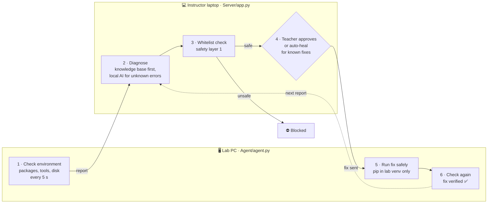

# LabMend: AI assistant for computer labs

LabMend keeps every lab PC ready for class. It finds broken Python environments and missing system requirements on lab PCs, explains each problem in plain English, and fixes Python packages safely from the instructor's laptop. Detection, diagnosis and the local AI run without any cloud service.

**Team TwinSpark:** Asvitha R, Thikshitha R

## Links
- Demo video: https://drive.google.com/drive/folders/1OxOuBNmbWpvv1p2B8csZML2uad-TYbi7?usp=sharing
- Presentation (PDF): https://drive.google.com/drive/folders/1xtoBvSr9FYnGJcq9P9FSayy8DKamtMT-?usp=sharing

## The problem
In a 90-minute coding lab, the first 20 or more minutes often go to missing packages, wrong versions and missing tools, fixed one PC at a time. Lab internet is often slow or restricted, so cloud tools can't help.

## How it works


1. **Check:** every lab PC checks its environment and reports to the instructor laptop.
2. **Diagnose:** the server explains each problem, using the knowledge base first and the local AI for unknown errors.
3. **Whitelist:** every proposed fix is checked, and anything unsafe is blocked.
4. **Approve:** the teacher approves with one click, or known fixes auto-heal.
5. **Fix:** the PC re-checks the command and runs pip only inside the lab environment.
6. **Verify:** the next check confirms the fix worked.

## Features
- **Live instructor console:** lab map, live counts, problem cards, and a history of every fix
- **Detects** missing, broken and wrong-version Python packages against the course's package list
- **One click, whole lab:** one approval fixes every PC with the same problem
- **Verified fixes:** every fix is confirmed by the agent's next check
- **Course profiles:** pick the next class (e.g. Week 5 · Data Science) and every PC checks itself against that course
- **Auto-heal policy:** known fixes from the knowledge base apply automatically; AI suggestions always wait for the teacher
- **System checks:** required tools and versions (Git, Node.js, Java), free disk space and environment variables. These are flagged with instructions, not installed, because that needs admin rights.
- **Crash capture:** `labrun.py` sends a student's crash to the dashboard
- **Local AI:** Qwen 2.5 0.5B via Ollama explains unknown errors on the instructor laptop, with no cloud API
- **Three safety layers:**
  1. A whitelist on the server
  2. A re-check on the PC, with pip running only inside the lab environment and no shell
  3. Teacher approval
- **Lightweight agents:** they use only Python's standard library, so nothing has to be installed on lab PCs

## What "offline" means
Detection, diagnosis, the dashboard and the AI all run on the lab network with no cloud service. Package fixes use pip, so the package files come from PyPI or a campus mirror. Serving packages from a local folder on the instructor laptop (`pip --find-links`) is our next step.

## Tech stack
Python · Flask · SQLite · HTML/CSS/JavaScript (canvas) · Ollama (Qwen 2.5 0.5B) · Git/GitHub

## Project structure
```text
Agent/agent.py          lab-PC agent: audit, report, apply fixes safely
Agent/labrun.py         runs a student's program and reports crashes
Server/app.py           Flask server and API
Server/diagnose.py      knowledge base + local AI diagnosis
Server/safety.py        whitelist (safety layer 1)
Server/db.py            SQLite database
Server/profiles/*.json  one package and requirement list per course
Server/kb.json          knowledge base texts and module aliases
Server/templates/       instructor dashboard
tools/lab.py            runs a demo lab of several PCs on one laptop
tests/                  sample student programs for the demo
```

## Run it (Windows, one laptop)
```text
python -m venv .venv
.venv\Scripts\activate
pip install -r Server\requirements.txt
```
- Terminal 1: `python Server\app.py`, then open http://localhost:5000
- Terminal 2: `python tools\lab.py setup 6`, then `python tools\lab.py start 6`

**Try it:**
- `python tools\lab.py break PC-03 missing colorama` → PC-03 turns red → click **Approve fix**
- Switch the **Course** on the dashboard → every PC is checked against that course
- `python Agent\labrun.py tests\test_bug.py --node-id PC-03 --lab-python labs\pc-03\Scripts\python.exe` → explained by the local AI
- `python tools\lab.py reset` → puts every PC back to Week 1

**Local AI (optional):** install Ollama, then run `ollama pull qwen2.5:0.5b`. Without it, LabMend still works with the knowledge base.

## In a real lab
Run the server on the instructor's laptop, and on each lab PC run:

`python Agent\agent.py --server http://<instructor-ip>:5000 --lab-python <path to the lab's python.exe>`

## Roadmap
- Local package cache on the instructor laptop, so fixes need no internet at all
- Snapshot and undo for fixes
- Installing system tools where admin rights allow
- More audit checks, such as GPU/CUDA
